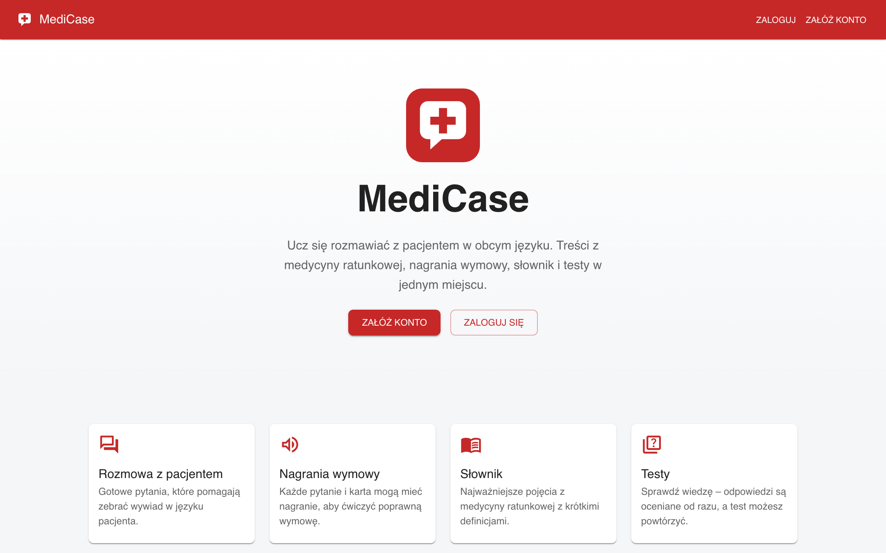
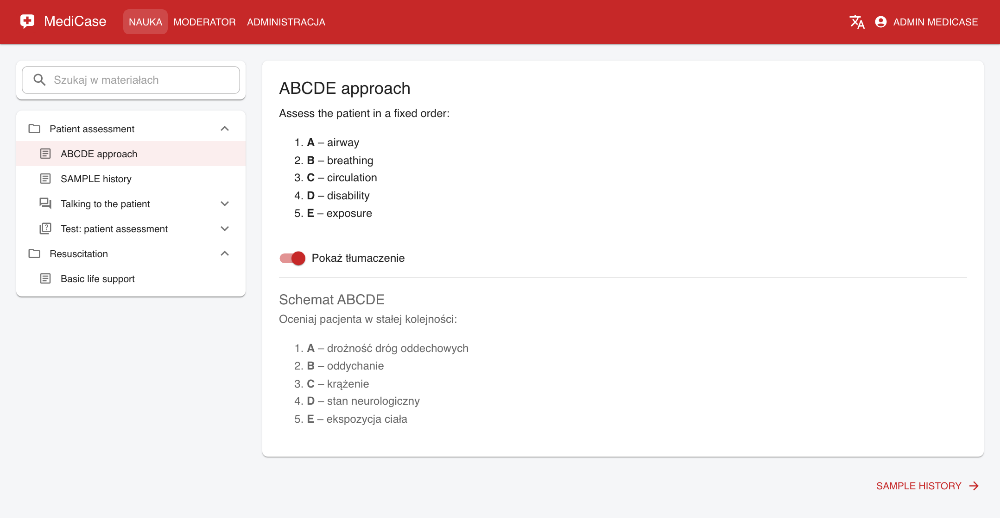
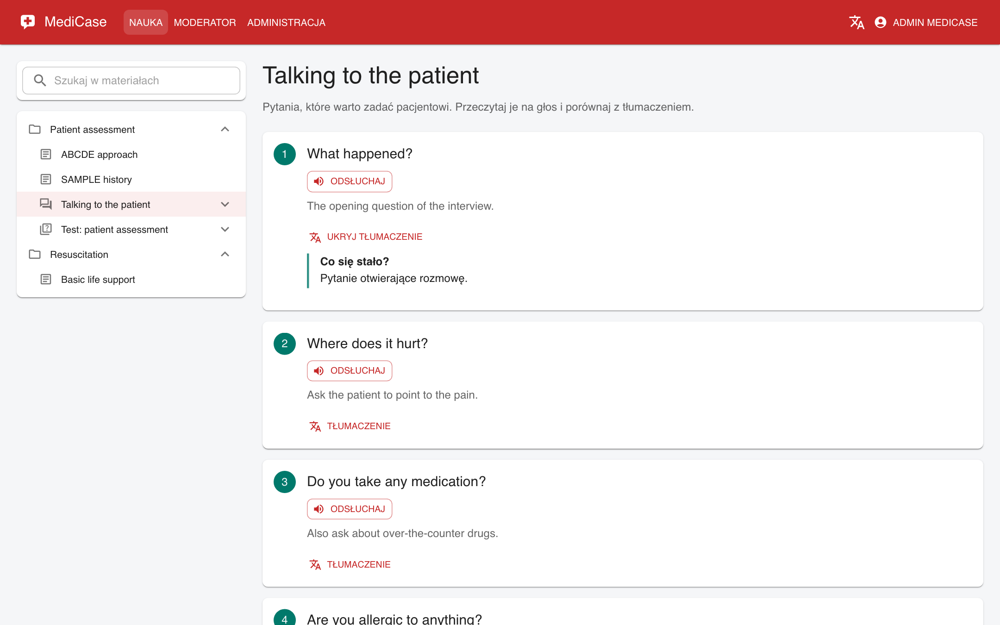
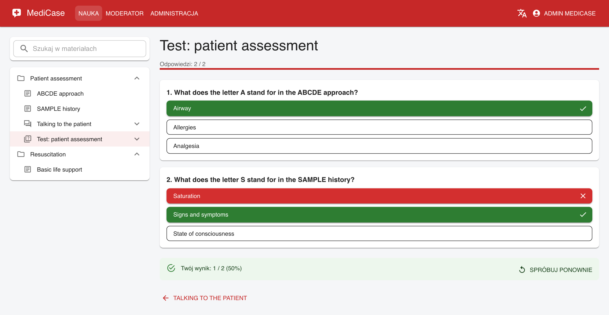
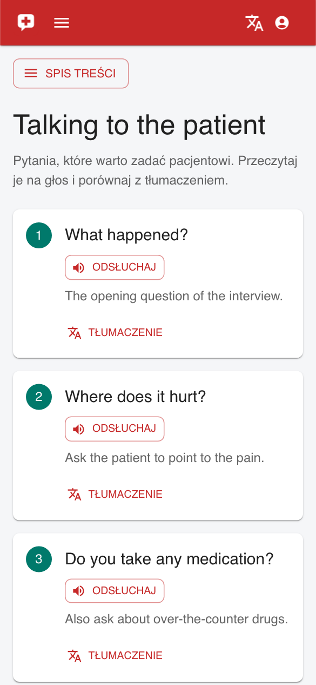
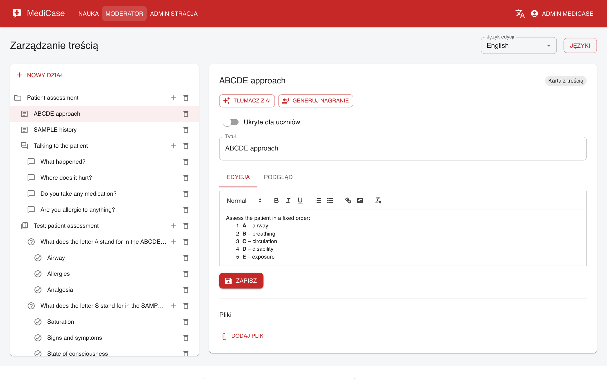
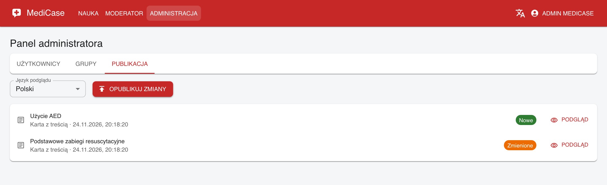
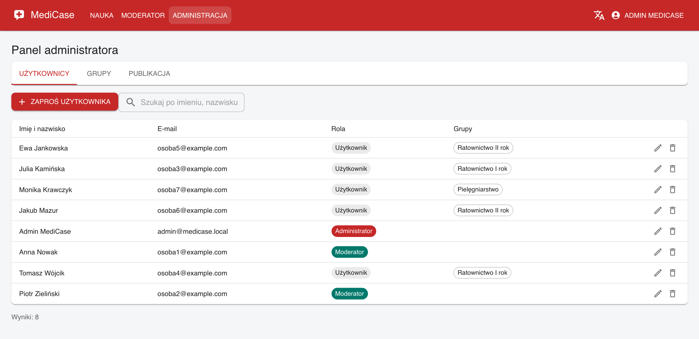

# MediCase

**MediCase** is a web application for learning how to talk to a patient in a foreign language. It combines emergency
medicine content, interview questions with pronunciation recordings, a glossary and tests. Moderators prepare the
content in many languages and administrators review and publish it.

The application was created during the *Programowanie zespołowe* (team programming) course in the 2022/2023
academic year, in cooperation with Collegium Medicum UMK, and was first presented in May 2023.



## What the application does

The user interface is in Polish and the learning content can be in any language added by moderators. The screenshots
show the sample content and fictional users.

### Learning

The learner chooses two languages: the one they learn and their own. Content is shown in the language they learn, and
the translation can be turned on for every card. Topics are organized in a tree with search.



**Patient interview** – ready questions to ask a patient, with a recording of the pronunciation and the translation:



**Tests** – every answer is checked right away, and the test ends with a score and can be repeated:



Sections can also have a **glossary** with short definitions. Everything works on a phone as well:



### Preparing content

Moderators build the content tree and edit each element in a rich text editor with a preview. The editor can translate
an element from another language (Amazon Translate) and generate its recording (Amazon Polly). Files can be attached
to every translation, and an unfinished element can be hidden from learners.



### Review and publishing

Moderators work on their own copy of the content, so learners do not see unfinished changes. The administrator sees
what is new, changed or removed, can preview it and publishes everything at once.



### Users and groups

Users sign in with Amazon Cognito. They can register on their own or be invited by an administrator, who also assigns
roles and groups.



| | User | Moderator | Administrator |
| --- | :---: | :---: | :---: |
| Learning, glossary and tests | ✓ | ✓ | ✓ |
| Editing content, languages and files, AI tools | | ✓ | ✓ |
| Reviewing and publishing changes | | | ✓ |
| Managing users and groups | | | ✓ |

## Repository structure

| Directory | Description | Tech stack |
| --- | --- | --- |
| [`backend`](backend) | REST API and AWS infrastructure | .NET 8, ASP.NET Core, Entity Framework Core, PostgreSQL, Terraform |
| [`frontend`](frontend) | Web client | React 19, Vite, TypeScript, Material UI |

Each directory has its own README with features, architecture, setup and deployment instructions.

## Running locally

Requirements: Docker and Node.js 22.

Start PostgreSQL, the local Cognito emulator and the API:

```bash
cd backend
cp .env.example .env   # fill in DB_PASSWORD and ADMIN_PASSWORD
docker compose up --build
```

Then start the client in another terminal:

```bash
cd frontend
npm ci
npm run dev
```

The application is available at <http://localhost:3000> and the API at <http://localhost:8080>.

## Tests

```bash
(cd backend && dotnet test)
(cd frontend && npm ci && npm test -- --run && npm run lint)
```

## CI

The workflows in [`.github/workflows`](.github/workflows) run separately for `backend/` and `frontend/`, only when files
of the given project change. They deploy to AWS only when the repository variables described in the project READMEs
are set.
